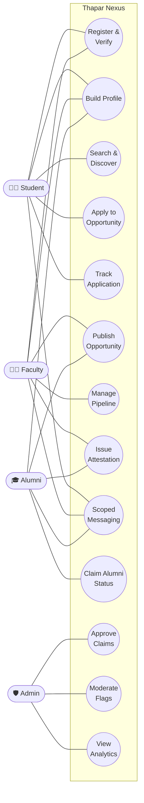
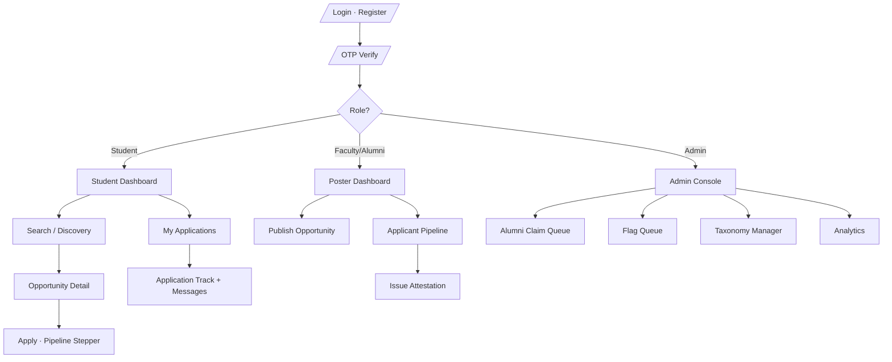
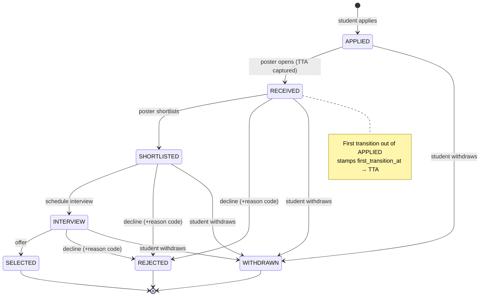
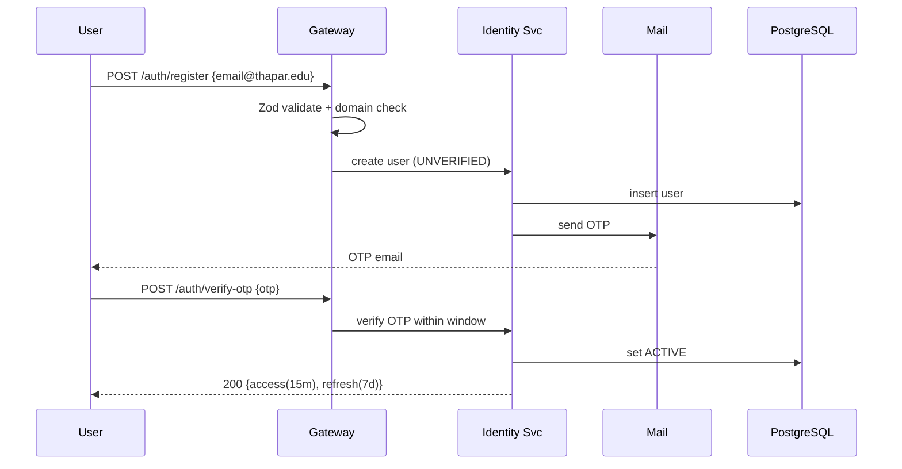
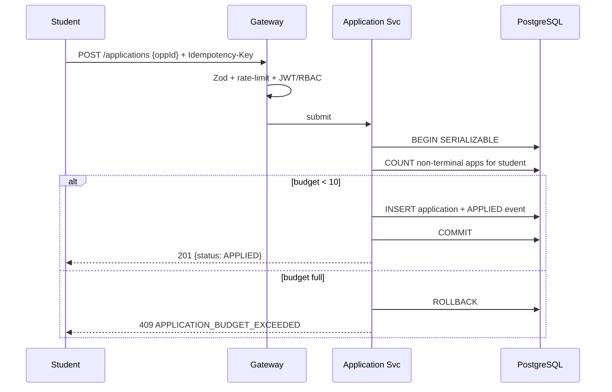
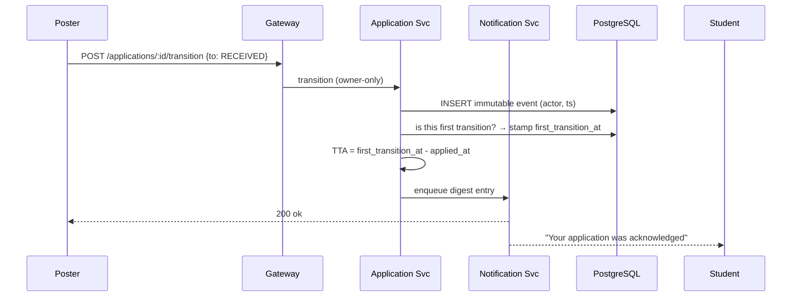
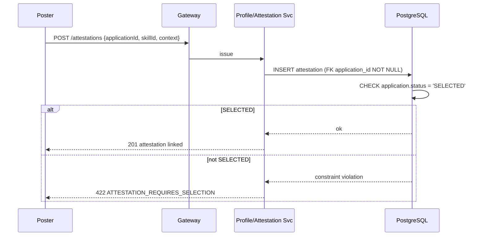
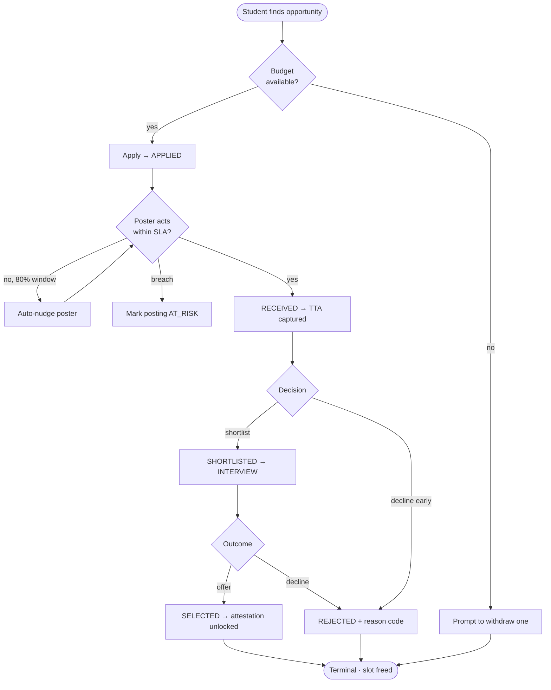
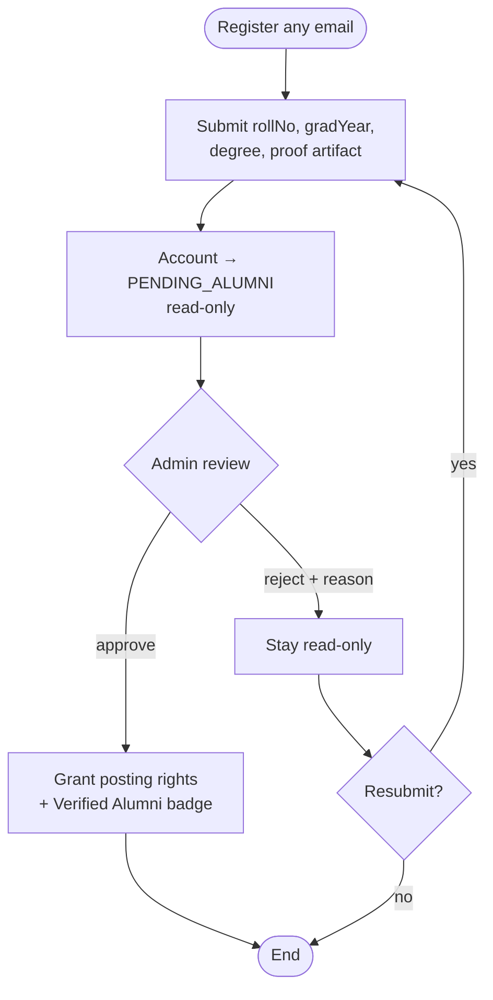

# 🔄 Application Flow & Behaviour
## Thapar Nexus — Use Cases, State Machine & Diagrams

`UCS503 Software Engineering` · **Document 3 of 8** · Derived from `MasterPlan.md`

---

## Table of Contents

1. [Use-Case Diagram](#1-use-case-diagram)
2. [Use-Case Specifications](#2-use-case-specifications)
3. [Screen Navigation Map (per role)](#3-screen-navigation-map-per-role)
4. [Application State Machine](#4-application-state-machine)
5. [Transition Table](#5-transition-table)
6. [Sequence Diagrams](#6-sequence-diagrams)
7. [Activity Diagrams](#7-activity-diagrams)
8. [Error & Empty States](#8-error--empty-states)

---

## 1. Use-Case Diagram

---

## 2. Use-Case Specifications

### UC-04 — Apply to Opportunity

| Field | Detail |
|---|---|
| **Actor** | Student |
| **Precondition** | Authenticated; opportunity is live (not `EXPIRED`); student below application budget |
| **Main flow** | 1. Student opens opportunity detail → 2. Clicks *Apply* → 3. System checks budget in a `SERIALIZABLE` txn → 4. Inserts `applications` row + `APPLIED` event → 5. Shows pipeline stepper at `APPLIED` |
| **Alternate A1** | Budget full → refuse with *"Withdraw one to apply"* |
| **Alternate A2** | Duplicate apply (same `Idempotency-Key`) → return the original application |
| **Alternate A3** | Deadline passed between load and submit → refuse; posting is `EXPIRED` |
| **Postcondition** | One live application exists; `applied_at` timestamped for TTA |

### UC-07 — Manage Applicant Pipeline

| Field | Detail |
|---|---|
| **Actor** | Faculty / Alumni (owner) |
| **Precondition** | Owns the opportunity; applicants exist |
| **Main flow** | 1. Open applicant list → 2. Select applicant → 3. Choose next state → 4. System writes immutable event with actor+timestamp → 5. First transition captures TTA → 6. Notification fired to student |
| **Alternate A1** | Move to `REJECTED` → owner must pick a reason code (S2) |
| **Alternate A2** | SLA window at 80% → system had already auto-nudged owner |
| **Postcondition** | New immutable `application_events` row; nothing edited or deleted |

### UC-08 — Issue Attestation

| Field | Detail |
|---|---|
| **Actor** | Faculty / Alumni |
| **Precondition** | A `SELECTED` application exists between actor and student |
| **Main flow** | 1. Open the selected application → 2. Choose skill + write context string → 3. System validates `SELECTED` via DB `CHECK` → 4. Attestation linked permanently to that application |
| **Alternate A1** | No `SELECTED` application → DB rejects; UI never offered the action |
| **Postcondition** | Attested skill renders with verified marker, ranks above self-claimed |

### UC-10 — Claim Alumni Status

| Field | Detail |
|---|---|
| **Actor** | Alumni |
| **Precondition** | Registered with any email |
| **Main flow** | 1. Submit roll no, grad year, degree, 1 proof artifact → 2. Account enters `PENDING_ALUMNI` (read-only) → 3. Admin reviews → 4. Approve → posting rights + badge |
| **Alternate A1** | Admin rejects with reason → account stays read-only, may resubmit |
| **Postcondition** | Approved alumni can post, attest, spend referral tokens |

---

## 3. Screen Navigation Map (per role)

---

## 4. Application State Machine

> **Non-terminal states** (`APPLIED`, `RECEIVED`, `SHORTLISTED`, `INTERVIEW`) count against the student's application budget. **Terminal states** (`SELECTED`, `REJECTED`, `WITHDRAWN`) free a slot.

---

## 5. Transition Table

| From | To | Allowed actor | Side effects | Notification |
|---|---|---|---|---|
| — | `APPLIED` | Student | Insert application + event; stamp `applied_at`; consume 1 budget slot | Poster: "new application" |
| `APPLIED` | `RECEIVED` | Owner | Stamp `first_transition_at`; **compute TTA** | Student: "acknowledged" |
| `RECEIVED` | `SHORTLISTED` | Owner | Event row | Student: "shortlisted" |
| `SHORTLISTED` | `INTERVIEW` | Owner | Event row; optional interview note | Student: "interview" |
| `INTERVIEW` | `SELECTED` | Owner | Event row; unlocks attestation; may fill seat | Student: "selected" |
| any active | `REJECTED` | Owner | Event row + **reason code (S2)**; free budget slot | Student: "rejected + reason" |
| any active | `WITHDRAWN` | Student | Event row; free budget slot; may trigger waitlist auto-fill (C6) | Poster: "withdrawn" |
| any | `EXPIRED`* | System | Posting-level auto-transition at deadline | Saved/applied students |

_\*`EXPIRED` is an opportunity state, shown here for completeness — applications on an expired posting are resolved per their current state._

---

## 6. Sequence Diagrams

### 6.1 Registration & Verification

### 6.2 Application Submission with Budget Check

### 6.3 Status Transition with TTA Capture

### 6.4 Attestation Issuance

---

## 7. Activity Diagrams

### 7.1 Application Lifecycle

### 7.2 Alumni Claim Flow

---

## 8. Error & Empty States

| Screen | Empty state | Error state |
|---|---|---|
| Search / Discovery | "No opportunities match — widen filters or save this search for alerts" | "Search temporarily unavailable — showing recent postings" |
| My Applications | "You haven't applied yet — discover opportunities" | "Couldn't load your pipeline — retry" |
| Applicant Pipeline | "No applicants yet — share the QR (C8) on a noticeboard" | "Pipeline failed to load — retry" |
| Profile | "Add skills from the taxonomy to appear in matches" | "Skill taxonomy unavailable — try again" |
| Attestation | "Attestations unlock when an application is SELECTED" | "Attestation requires a completed engagement" |
| Notifications | "You're all caught up" | "Digest unavailable" |
| Admin claim queue | "No pending alumni claims" | "Queue unavailable" |

---

[← TechSpecifications](TechSpecifications.md) &nbsp;·&nbsp; **AppFlow** &nbsp;·&nbsp; [Design →](Design.md)

