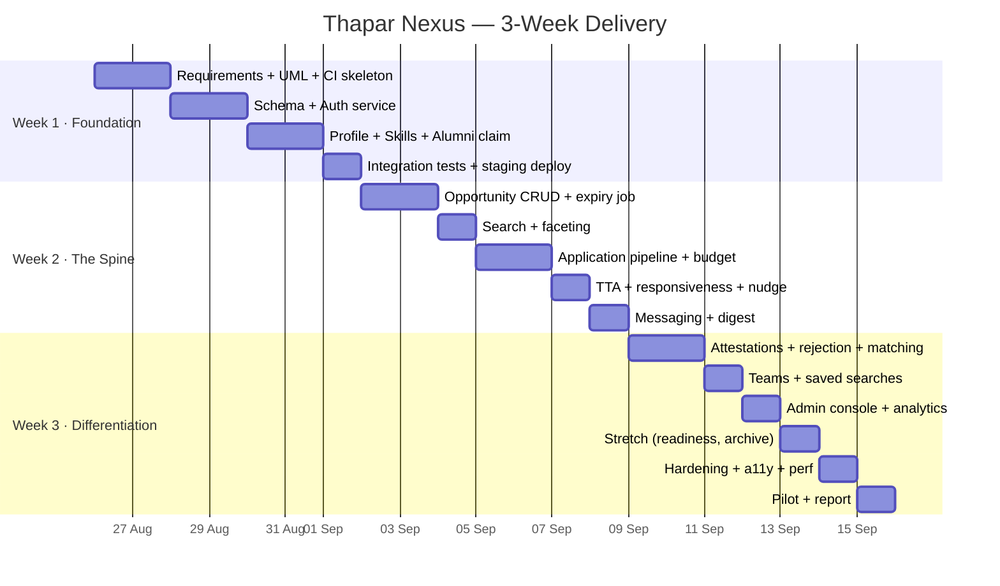
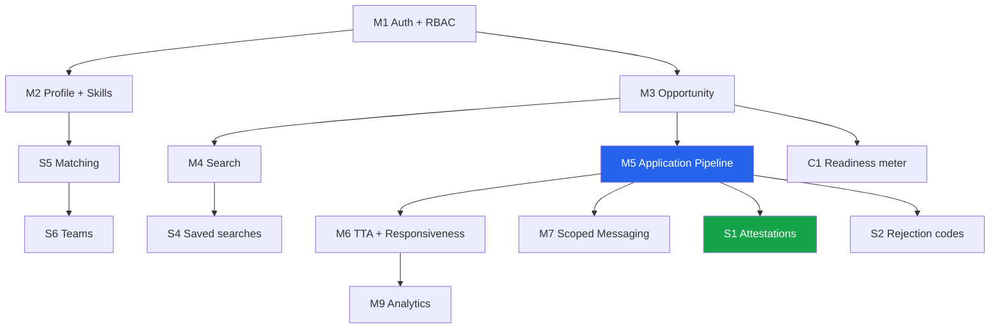

# 🗓️ Implementation Plan
## Thapar Nexus — Phased Delivery, Gates, Tests & Pilot Protocol

`UCS503 Software Engineering` · **Document 6 of 8** · Derived from `MasterPlan.md`

---

## Table of Contents

1. [Delivery Overview](#1-delivery-overview)
2. [Phase 1 — Foundation (Week 1)](#2-phase-1--foundation-week-1)
3. [Phase 2 — The Spine (Week 2)](#3-phase-2--the-spine-week-2)
4. [Phase 3 — Differentiation & Hardening (Week 3)](#4-phase-3--differentiation--hardening-week-3)
5. [Milestone Gates (Go / No-Go)](#5-milestone-gates-go--no-go)
6. [Dependency Graph](#6-dependency-graph)
7. [Test Plan](#7-test-plan)
8. [Risk Register](#8-risk-register)
9. [Rollback Plan](#9-rollback-plan)
10. [Pilot Execution Protocol](#10-pilot-execution-protocol)

---

## 1. Delivery Overview

**Guiding rule:** the **Week 2 milestone is the hard gate.** If Week 3 collapses entirely, the Week-2 product still passes. The Could tier is touched **only after** the spine passes.

---

## 2. Phase 1 — Foundation (Week 1)

| Days | Deliverables | Exit criteria |
|---|---|---|
| **D1–D2** | Requirements freeze, SRS, UML (use-case, class, activity, sequence), wireframes, ER diagram, repo + CI skeleton | All 8 docs baselined; CI runs lint→typecheck on a hello-world PR |
| **D3–D4** | DB schema, Prisma migrations, seed data, auth service (register, verify, login, refresh, RBAC middleware) | A user can register + verify via API; migrations apply in CI |
| **D5–D6** | Profile CRUD, skill taxonomy, user-skill assignment, alumni claim flow | Profile with skill tags persists; alumni claim enters `PENDING_ALUMNI` |
| **D7** | Integration tests for auth + profile; deploy to staging | Auth/profile integration suite green; staging URL live |

> **🎯 Milestone 1:** *A verified user can register, log in, and build a complete skill-tagged profile on a live URL.*

---

## 3. Phase 2 — The Spine (Week 2)

| Days | Deliverables | Exit criteria |
|---|---|---|
| **D8–D9** | Opportunity CRUD, structured fields, SLA pledge, deadline expiry job | Posting publishes with all typed fields; expiry job flips past-deadline to `EXPIRED` |
| **D10** | Search + faceting — FTS, GIN index, filter API, results UI | Faceted search returns correct results; p95 < 300ms on seed data |
| **D11–D12** | Application submission, budget enforcement, status pipeline, event log, poster applicant view | Budget race-safe; every transition writes an immutable event; poster sees pipeline |
| **D13** | TTA computation, responsiveness badge, nudge job | TTA correct from timestamps; nudge fires at 80% window; `AT_RISK` on breach |
| **D14** | Scoped messaging, notification digest, preferences | Thread scoped to app/team; digest batches per preference |

> **🎯 Milestone 2 (HARD GATE):** *Full loop closed end to end — post, discover, apply, transition, notify, measure.* **This is the demoable product. If Week 3 collapses entirely, you still pass on this.**

---

## 4. Phase 3 — Differentiation & Hardening (Week 3)

| Days | Deliverables | Exit criteria |
|---|---|---|
| **D15–D16** | Attestations, rejection reason codes, explainable matching | Attestation blocked unless `SELECTED`; matches show matched+missing tags |
| **D17** | Team formation, saved searches + alerts | Complementarity matching fills roles; saved search yields digest entries |
| **D18** | Admin console, moderation queue, analytics dashboard | Admin works claim + flag queues; analytics render institute metrics |
| **D19** | Stretch tier — readiness meter, then interview archive (in that order; **cut without hesitation if behind**) | Whatever ships is stable; nothing half-built merged |
| **D20** | Test completion, accessibility pass, performance pass, seed pilot dataset | WCAG AA checks pass; perf budget met; pilot data seeded |
| **D21** | Pilot run, metric collection, report, demo rehearsal | Real TTA numbers captured; report drafted |

> **🎯 Milestone 3:** *Pilot executed, real TTA numbers in hand.*

---

## 5. Milestone Gates (Go / No-Go)

| Gate | Go condition | No-Go action |
|---|---|---|
| **G1** (end W1) | Verified registration + profile live on staging | Freeze features; fix auth before proceeding |
| **G2** (end W2) | End-to-end loop demoable; immutable events + TTA correct | **Stop all Should/Could work**; harden the spine only |
| **G3** (end W3) | Pilot ran, metrics collected | Ship recorded fallback demo; report on partial data |

---

## 6. Dependency Graph

**Critical path:** Auth → Opportunity → Application → TTA. Everything of value depends on the application record existing.

---

## 7. Test Plan

### 7.1 Levels & Targets

| Level | Tool | Scope | Target |
|---|---|---|---|
| **Unit** | Vitest | Services, validators, TTA/Jaccard/budget logic | ≥ 80% on domain logic |
| **Integration** | Supertest | API endpoints incl. auth, budget race, transition immutability | All Must scenarios pass |
| **E2E** | Playwright | Happy paths across roles | All green before merge to `main` |

### 7.2 Key Integration Scenarios

| ID | Scenario | Expected |
|---|---|---|
| IT-01 | Register with non-`@thapar.edu` | Rejected |
| IT-02 | Concurrent double-apply at budget edge | Exactly one succeeds (SERIALIZABLE) |
| IT-03 | Attempt attestation without `SELECTED` | 422, DB CHECK holds |
| IT-04 | Transition writes immutable event; UPDATE/DELETE denied | Permission error |
| IT-05 | SLA breach flips posting to `AT_RISK` | Job marks + nudges |
| IT-06 | Thread creation without app or team | Rejected by CHECK |
| IT-07 | Expired posting refuses new application | 409/410 |

### 7.3 E2E Happy Paths

1. Student registers → builds profile → searches → applies → tracks to `SELECTED`.
2. Faculty posts → reviews pipeline → transitions → issues attestation.
3. Alumni claims → admin approves → alumni posts referral.

### 7.4 Acceptance Criteria per Must Feature

Each Must feature is accepted when its `Given/When/Then` criteria in `PRD.md` §6 pass in the integration suite and are traced in `Tracker.md`.

---

## 8. Risk Register

| Risk | Likelihood | Impact | Mitigation |
|---|---|---|---|
| Scope creep into Could tier | High | High | Week-2 milestone is the hard gate; Could touched only after it passes |
| Pilot participants don't engage | Medium | High | Recruit before Week 3; seed realistic data; fixed 90-min live pilot window |
| Search performance | Low | Medium | GIN index from day one; documented 300ms/50k migration threshold |
| Team member unavailable | Medium | Medium | Per-module named owner + backup; no single-owner critical path |
| Deployment failure at demo | Medium | High | Staging + production parity; **recorded fallback demo video** |
| Budget race condition | Low | High | SERIALIZABLE txn / advisory lock; IT-02 regression test |
| Auth/token bugs | Medium | High | Rotating refresh + theft detection; integration coverage before profile work |

---

## 9. Rollback Plan

| Scenario | Action |
|---|---|
| Bad migration | Expand→contract pattern; revert via documented manual rollback in the PR; redeploy previous image |
| Broken deploy | Vercel instant rollback to last green deployment |
| Data corruption | Soft-delete means no destructive loss; restore from managed Postgres PITR |
| Demo-day outage | Switch to recorded fallback demo; present staging |

---

## 10. Pilot Execution Protocol

### 10.1 Recruitment
15–25 students + 3–5 faculty/alumni, recruited **before Week 3**. Confirm a fixed **90-minute live pilot window**.

### 10.2 Briefing Script (read to participants)
> "This is a pipeline for institute opportunities. Students: find something relevant, apply, and watch its status. Posters: publish an opening and move applicants through the pipeline. We're measuring how fast applications get acknowledged — please act as you naturally would."

### 10.3 Task List

| Role | Tasks |
|---|---|
| Student | Register/verify · build profile with ≥3 skills · find a relevant posting (timed) · apply · check status |
| Poster | Publish 1 opportunity with SLA pledge · acknowledge + transition ≥2 applicants · issue 1 attestation |
| Admin | Approve 1 alumni claim · view analytics |

### 10.4 Data Collection
- **Instrumented (day-one analytics):** discovery time, TTA, resolution rate, transition timeline.
- **Baseline (pre-pilot interviews):** perceived wait time, count of never-answered applications.
- **Report the gap** between perceived and measured TTA — an interesting finding in itself.

### 10.5 Debrief Questions
1. How quickly did you find a relevant opportunity?
2. Did you always know where your application stood? (Likert 1–5, target ≥ 4.0)
3. Compared to email/WhatsApp, did you get an answer faster?
4. What one thing would you change?

---

[← Schema](Schema.md) &nbsp;·&nbsp; **ImplementationPlan** &nbsp;·&nbsp; [Tracker →](Tracker.md)

_The Week-2 gate is sacred: a demoable spine beats a half-built differentiator._

