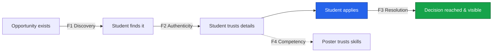
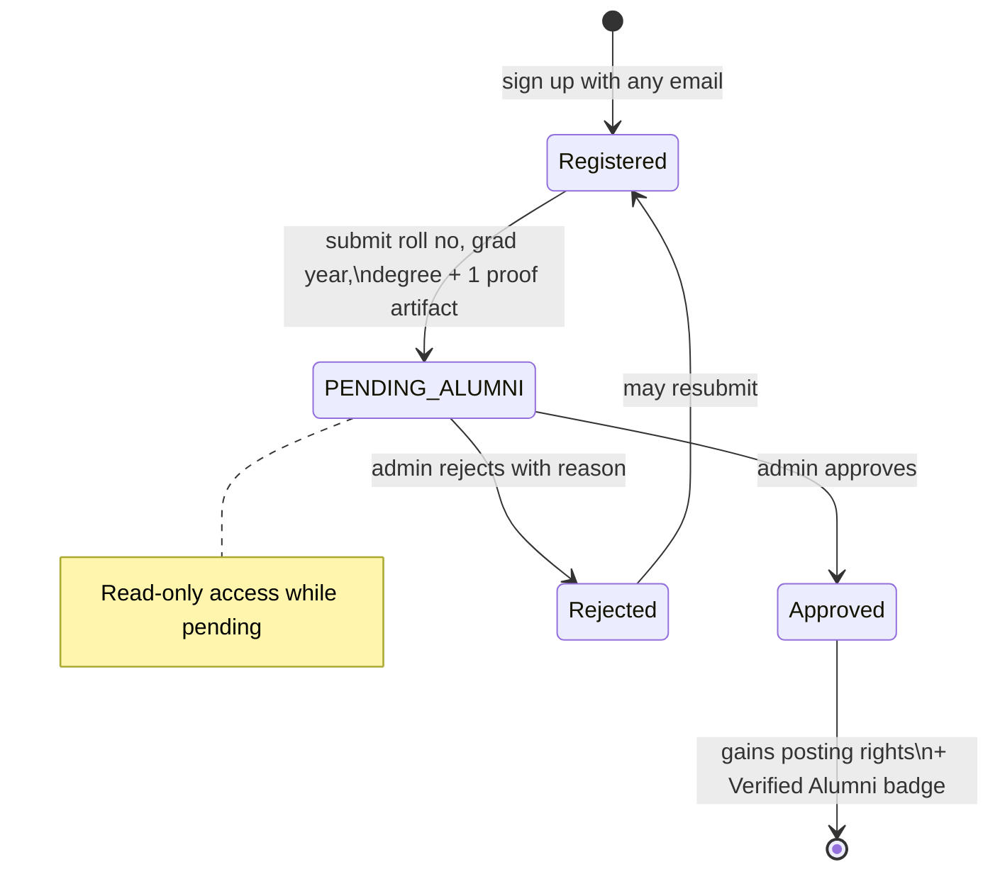

# 📋 Product Requirements Document
## Thapar Nexus — A Verified Opportunity Pipeline

`UCS503 Software Engineering` · `Thapar Institute of Engineering & Technology`

**Document 1 of 8** &nbsp;•&nbsp; Status: **Baseline** &nbsp;•&nbsp; Derived from `MasterPlan.md`

---

> **One-line definition**
> **Thapar Nexus is a verified opportunity pipeline for the institute — it exists to make sure an application reaches a decision, and to make it visible when it doesn't.**
>
> Not a network. Not a feed. **A pipeline with accountability.**

---

## Table of Contents

| # | Section | # | Section |
|---|---------|---|---------|
| 1 | [Document Control](#1-document-control) | 7 | [Non-Functional Requirements](#7-non-functional-requirements-nfrs) |
| 2 | [Vision & Problem Statement](#2-vision--problem-statement) | 8 | [Success Metrics](#8-success-metrics) |
| 3 | [Positioning & Non-Goals](#3-positioning--non-goals) | 9 | [Assumptions & Dependencies](#9-assumptions--dependencies) |
| 4 | [Personas](#4-personas) | 10 | [Out of Scope](#10-out-of-scope-wont-this-cycle) |
| 5 | [Feature Set — MoSCoW](#5-feature-set--moscow) | 11 | [Glossary](#11-glossary) |
| 6 | [User Stories & Acceptance Criteria](#6-user-stories--acceptance-criteria) | | |

---

## 1. Document Control

| Field | Value |
|---|---|
| **Product name** | Thapar Nexus |
| **Course** | UCS503 — Software Engineering |
| **Team** | Harshdeep Athawale (1024031062), Aakriti Chauhan (1024031055), Sehaj Dhillon (1024030620) |
| **Institute** | Thapar Institute of Engineering & Technology, Patiala |
| **Repository** | https://github.com/HarshdeepAthawale/UCS503-Software-Engineering |
| **Document owner** | Harshdeep Athawale |
| **Artifact mapping** | SRS (functional + non-functional requirements) |
| **Source of truth** | `MasterPlan.md` — this document must never contradict it |

---

## 2. Vision & Problem Statement

### 2.1 Vision

Opportunities inside the institute — research assistantships, TA positions, internships, hackathon teams, referrals — circulate through **WhatsApp groups, noticeboards, and word of mouth**. The circulation is channel-dependent, provenance is lost, and once an application is sent it disappears into silence. Thapar Nexus replaces that informal, lossy pipeline with a **structured, accountable one** where every application is a first-class record whose journey to a decision is tracked, timestamped, and made visible.

The product is deliberately **anti-engagement**. It succeeds when a student spends *less* time on it and gets a *faster* result.

### 2.2 The Four Failures (ranked)

Nexus targets **F3 as the primary problem** and treats F1, F2, F4 as enablers. Stating this ranking explicitly is a maturity signal — a project with a *ranked* problem list reads far stronger than one with a flat list.

| ID | Failure | Description | Priority |
|----|---------|-------------|----------|
| **F3** | **Resolution failure** | Applications sent by email vanish. A student cannot distinguish *rejected*, *still reading*, and *never opened*. There is **no accountability for silence**. | 🔴 **Primary** |
| **F1** | Discovery failure | Postings are missed because circulation is channel-dependent. A student not in the right group never sees the opening. | 🟠 Enabler |
| **F2** | Authenticity failure | Forwarded messages lose provenance. Deadlines drift, details mutate, and there is no way to confirm who actually posted. | 🟠 Enabler |
| **F4** | Competency failure | Every profile is self-claimed. A poster has no way to verify that a claimed skill corresponds to real work. | 🟠 Enabler |

---

## 3. Positioning & Non-Goals

> This section is the **most important** in the PRD. A similar-sounding campus project exists in the same cohort. The difference must be **structural, not cosmetic** — visible in the schema and the metrics, not just the pitch.

### 3.1 The Fundamental Split

| Dimension | Social / feed app | **Thapar Nexus** |
|---|---|---|
| Atomic unit | Post | **Opportunity + Application** |
| Success metric | Engagement, time-on-app | **Time-to-Acknowledgement, decision rate** |
| Content lifetime | Permanent, accumulating | **Deadline-bound, auto-expiring** |
| Identity value | Follower count, popularity | **Verified role + attested skills** |
| Core loop | Browse → react → return | **Discover → apply → track → resolve** |
| Failure mode it fixes | Boredom | **Ghosting and missed opportunities** |
| Who holds power | The most-followed | **The most-responsive** |
| Optimal user behaviour | Use it more | **Use it *less*, get a result faster** |

> **The thesis lives in the last row.** Nexus is designed to *reduce* the time a student spends on it. A student succeeds when they find a posting in under two minutes, apply, and get an answer in under 48 hours.

### 3.2 Hard Exclusions — Explicit Non-Goals

Nexus will **not** have any of the following. Each one optimises for **attention capture**, which is directly opposed to the stated success metric. Excluding them is a **design decision, not a scope cut.**

| ❌ Excluded | Why it is excluded |
|---|---|
| Infinite scrolling feed | Optimises for time-on-app; opposes discovery-under-two-minutes |
| Likes / reactions | Vanity signal; adds noise, no decision value |
| Follower / following counts | Popularity ≠ responsiveness; wrong power structure |
| Stories / reels | Ephemeral engagement bait |
| Public comment threads | Moderation burden with no pipeline value |
| DMs unattached to an opportunity | Harassment surface; replaced by **scoped messaging** |
| Profile visit counters | Vanity metric |
| Any other vanity metric | Contradicts the product's reason to exist |

### 3.3 What Only Nexus Can Do

Four capabilities **structurally impossible** in a social app, because they depend on the **application record existing as a first-class entity**:

1. **Attestation anchored to work** — an endorsement that *requires* a completed application between the two parties.
2. **Ghosting accountability** — a responsiveness metric computed from **state-transition timestamps**.
3. **Two-sided load control** — application budgets and posting-capacity limits.
4. **Demand-side skill analytics** — telling a student what to learn based on aggregated *live* postings.

---

## 4. Personas

### 4.1 👩‍🎓 Priya — The Applicant (Student)

| Attribute | Detail |
|---|---|
| Role | 3rd-year CSE student |
| Verification | `@thapar.edu` email + OTP |
| Goal | Land a research assistantship before placements; know *where she stands* on each application |
| Pain | Emails 6 professors, hears back from none, cannot tell if they were even read |
| Nexus behaviour | Faceted search → apply within budget → watch the pipeline stepper move → get an attested skill on selection |

> **Scenario.** Priya filters `Research + Machine Learning + PyTorch`, finds a posting in 90 seconds, applies (using 1 of her 10 application slots), and sees `APPLIED`. Within 48h the professor moves her to `SHORTLISTED` — she gets a digest entry, not a silence.

### 4.2 👨‍🏫 Dr. Rao — The Poster (Faculty)

| Attribute | Detail |
|---|---|
| Role | Assistant Professor, publishes RA/TA openings |
| Verification | `@thapar.edu` email + admin role grant |
| Goal | Fill an NLP RA seat with a genuinely skilled student, fast |
| Pain | Inbox flooded with unstructured emails; cannot compare applicants |
| Nexus behaviour | Publishes structured posting with **SLA pledge** → reviews a ranked pipeline → issues an **attestation** on selection |

> **Scenario.** Dr. Rao posts an RA opening with a **48h SLA pledge** and 2 seats. He gets nudged at 80% of the window, moves applicants through the pipeline, and his **Responsiveness Badge** (median TTA) is shown on all his future postings.

### 4.3 🎓 Anjali — The Alumna

| Attribute | Detail |
|---|---|
| Role | Graduated 2023, now at a product company |
| Verification | **Claim-and-approve flow** (§4.4 below) — she no longer has a `@thapar.edu` address |
| Goal | Refer juniors, post internships, share interview experiences |
| Pain | Loses institute email after graduation → the naive `@thapar.edu` rule locks her out |
| Nexus behaviour | Claims her identity → admin approves → posts referrals, spends **referral tokens**, contributes to the interview archive |

### 4.4 🛡️ Karan — The Administrator

| Attribute | Detail |
|---|---|
| Role | Placement-cell / department admin |
| Verification | Seeded account |
| Goal | Keep the pipeline trustworthy — verify alumni, moderate flags, manage the skill taxonomy |
| Nexus behaviour | Works the **alumni claim queue**, resolves flags with reason codes, views institute analytics |

### 4.5 Alumni Verification Flow (the gap that was caught)

The naive proposal restricts sign-up to `@thapar.edu`. **Alumni lose that address after graduation, making the alumni role unreachable.** The fix:

This gives the **admin role real work** rather than being decorative, and demonstrates requirements analysis that went past the happy path.

---

## 5. Feature Set — MoSCoW

The **Must** tier alone is a complete, demonstrable, gradeable product. Everything above it is upside.

### 5.1 🟥 MUST — The Spine _(target: end of Week 2)_

| ID | Feature | Essence |
|----|---------|---------|
| **M1** | Institutional identity & roles | Domain-restricted registration, email OTP, JWT access+refresh, RBAC middleware, alumni claim queue |
| **M2** | Structured profiles + controlled skill vocabulary | Admin-curated taxonomy (no free text), academic details, projects w/ repo links, skill tags + proficiency |
| **M3** | Structured opportunity postings | Typed fields, required/preferred skills, seats, deadline, **SLA pledge**, auto-`EXPIRED` job |
| **M4** | Faceted discovery | FTS over title+description + filters + sort; **< 2 min to a relevant posting** |
| **M5** | Application pipeline | `APPLIED → RECEIVED → SHORTLISTED → INTERVIEW → SELECTED \| REJECTED \| WITHDRAWN`, immutable event log |
| **M6** | Time-to-Acknowledgement & SLA pledges | TTA from DB timestamps only; auto-nudge at 80%; `AT_RISK` on breach; **Responsiveness Badge** |
| **M7** | Scoped messaging | Threads exist only within an application or team — **no free-form DMs** (safety by design) |
| **M8** | Notification digest | Batched (immediate/daily/weekly per category); deadline reminders at T−72h and T−24h |
| **M9** | Admin console | Claim queue, flag queue w/ reason codes, role escalation, taxonomy mgmt, analytics |

### 5.2 🟨 SHOULD — The Differentiators _(target: Week 3)_

| ID | Feature | Why it matters |
|----|---------|----------------|
| **S1** | **Skill attestations anchored to real work** | Requires a **`SELECTED` application** to exist → competency is *unfarmable*. **Lead with this.** |
| **S2** | Structured rejection feedback | One-click reason codes → real signal for students, aggregate domain insight |
| **S3** | Application budget (default 10 non-terminal) | One constraint solves student spam *and* poster overload |
| **S4** | Saved searches & alerts | Pull-based, intentional — the correct replacement for a feed |
| **S5** | Explainable matching (Jaccard) | Always shows *why*: "matched on Python, PyTorch — missing: CUDA". Never a bare score |
| **S6** | Team formation for hackathons | Matches for **complementarity**, not similarity — a distinct algorithm |
| **S7** | Verified project artifacts | Background job fetches public repo metadata to prove the artifact is real |

### 5.3 🟩 COULD — Stretch _(only if the spine is stable)_

| ID | Feature |
|----|---------|
| **C1** | Readiness meter — the 3 skills that unlock the most currently-open opportunities |
| **C2** | Interview experience archive (verified submitters only) |
| **C3** | Referral tokens (scarce quota per alumnus per cycle) |
| **C4** | Transparency board (anonymised institute stats, never per-individual shaming) |
| **C5** | Blind screening mode (hide name/photo/gender/branch until shortlist) |
| **C6** | Waitlist auto-fill on withdrawal |
| **C7** | Calendar `.ics` export |
| **C8** | QR bridge for physical noticeboards |
| **C9** | Recommendation-letter workflow |

### 5.4 ⬜ WON'T — This Cycle _(scope boundary)_

Native mobile apps · institutional SSO/LDAP · video interviews/calls · payment or stipend disbursement · public feed of any kind · AI-generated profile/posting content · resume parsing · cross-institute federation.

> Listing these explicitly is a **scope-management artifact** — it reads as deliberate rather than incomplete.

---

## 6. User Stories & Acceptance Criteria

Grouped by MoSCoW tier. Acceptance criteria are in **Given / When / Then** form.

### 6.1 MUST

**US-M1.1 — Domain-restricted registration**
> _As a student, I want to register with my `@thapar.edu` email so that only institute members can join._

- **Given** a visitor on the sign-up page **When** they submit an email not ending in `@thapar.edu` **Then** registration is rejected with a clear message.
- **Given** a valid `@thapar.edu` email **When** they submit **Then** an OTP is emailed and the account enters `UNVERIFIED`.
- **Given** a correct OTP within its validity window **When** submitted **Then** the account becomes `ACTIVE` and JWT access + refresh tokens are issued.

**US-M3.1 — Publish a structured opportunity**
> _As a faculty member, I want to publish an opportunity with typed fields and an SLA pledge so that applicants get accurate, accountable information._

- **Given** an authenticated faculty user **When** they submit a posting missing a required field (title, type, deadline, or SLA pledge) **Then** Zod validation blocks it with a field-level error.
- **Given** a valid posting **When** published **Then** it appears in search within one refresh and its `search_vector` is populated.
- **Given** the deadline passes **When** the expiry job runs **Then** the posting auto-transitions to `EXPIRED` and no longer accepts applications.

**US-M5.1 — Apply and track**
> _As a student, I want every status change on my application recorded immutably so that I always know where I stand._

- **Given** a live opportunity and an available application slot **When** the student applies **Then** an `applications` row + an `APPLIED` `application_events` row are created atomically.
- **Given** a poster transitions the application **When** the transition commits **Then** a new immutable event row is written (never an edit/delete) and the student sees the full history.
- **Given** the student is at their application budget (10 non-terminal) **When** they try to apply again **Then** the attempt is refused until they withdraw one.

**US-M6.1 — Time-to-Acknowledgement**
> _As a student, I want acknowledgement time measured from real timestamps so that responsiveness is objective, not self-reported._

- **Given** an application with `applied_at` **When** the first non-`APPLIED` transition occurs **Then** `TTA = first_transition_at − applied_at` is computable and correct.
- **Given** a posting with a 48h SLA pledge **When** 80% of the window elapses without a transition **Then** the poster is auto-nudged.
- **Given** the pledge window is breached **When** the check job runs **Then** the posting is marked `AT_RISK`.

### 6.2 SHOULD

**US-S1.1 — Attestation anchored to work**
> _As a professor, I want to attest to a student's skill only where a completed engagement exists so that attestations cannot be farmed._

- **Given** an application with `status = SELECTED` between poster and student **When** the poster issues an attestation with a context string **Then** it is permanently linked to that application.
- **Given** no `SELECTED` application exists between the two parties **When** an attestation is attempted **Then** the database `CHECK` constraint rejects it (enforced in schema, not service code).
- **Given** an attested skill **When** it renders in search **Then** it shows a verified marker and ranks above self-claimed skills.

**US-S5.1 — Explainable matching**
> _As a student, I want to see why a match was suggested so that the recommendation is trustworthy._

- **Given** a suggested peer or opportunity **When** it renders **Then** the UI shows matched tags and missing tags explicitly — never a bare score.

### 6.3 COULD

**US-C1.1 — Readiness meter**
> _As a student, I want to know which skills unlock the most open opportunities so that I can learn strategically._

- **Given** the student's tag set and all live postings in a domain **When** the meter computes **Then** it surfaces the top 3 skills that would unlock the largest number of currently-open opportunities.

---

## 7. Non-Functional Requirements (NFRs)

| ID | Category | Requirement | Target / Standard |
|----|----------|-------------|-------------------|
| **NFR-P1** | Performance | Faceted search p95 latency | ≤ **300 ms** (migration trigger threshold) |
| **NFR-P2** | Performance | Discovery time (session start → first detail view) | < **2 min** |
| **NFR-S1** | Security | Password/secret handling | Argon2/bcrypt hashing; secrets never committed |
| **NFR-S2** | Security | Transport | HTTPS only; JWT access 15m + refresh 7d rotating |
| **NFR-S3** | Security | Input validation | Zod at every boundary; parameterised queries only |
| **NFR-S4** | Security | Rate limiting | Redis token bucket per user & per IP on auth, apply, messaging |
| **NFR-A1** | Availability | Uptime of login + submission paths | ≥ **99%** |
| **NFR-AC1** | Accessibility | Conformance | **WCAG 2.1 AA** — contrast, keyboard nav, ARIA, never colour-only status |
| **NFR-PR1** | Privacy | Default visibility | CGPA + contact details **private by default**; field-level controls |
| **NFR-PR2** | Privacy | Data minimisation | No personal data in URLs/query strings; soft-delete everywhere |
| **NFR-M1** | Maintainability | Type safety | TypeScript strict mode, no `any`, one Zod schema shared client/server |
| **NFR-O1** | Observability | Auditability | Every privileged action written to append-only `audit_log` |

---

## 8. Success Metrics

### 8.1 Primary

> **Median Time-to-Acknowledgement ≤ 48 hours** across the pilot — computed as `first_transition_at − applied_at` from `application_events`. **Fully attributable, never self-reported.**

### 8.2 Secondary

| Metric | Definition | Target |
|---|---|---|
| Discovery time | Session start → first opportunity detail view | < 2 min |
| Resolution rate | Applications reaching a terminal state before deadline + 7d | ≥ 80% |
| Match relevance | Suggested peers actually contacted / suggested | ≥ 30% |
| Status clarity | Self-reported, 5-point Likert | ≥ 4.0 |
| Attestation adoption | Selected applications resulting in an attestation | ≥ 25% |
| Availability | Uptime of login and submission paths | ≥ 99% |

### 8.3 Method

Pilot with **15–25 students** and **3–5 faculty/alumni**. Establish a baseline through structured pre-pilot interviews on the current informal workflow (perceived wait time, count of never-answered applications). **The gap between _perceived_ wait and _measured_ TTA is itself a finding worth reporting.** Instrument analytics events from **day one** — retrofitting in Week 3 never works.

---

## 9. Assumptions & Dependencies

| Type | Item |
|---|---|
| Assumption | Students and faculty have valid `@thapar.edu` addresses; alumni can produce one proof artifact |
| Assumption | Pilot participants can be recruited before Week 3 |
| Assumption | Pilot corpus stays under ~50k documents (Postgres FTS remains sufficient) |
| Dependency | Email provider for OTP delivery |
| Dependency | Managed Postgres (Neon/Railway) + Redis on free tier |
| Dependency | Vercel for app hosting with per-PR preview deployments |
| Dependency | Public repo metadata API (for S7 verified artifacts) |

---

## 10. Out of Scope (WON'T this cycle)

See §5.4. Restated for the SRS boundary: native mobile, SSO/LDAP, video calls, payments, public feed, AI-generated content, resume parsing, cross-institute federation.

---

## 11. Glossary

| Term | Meaning |
|---|---|
| **TTA** | Time-to-Acknowledgement — `first_transition_at − applied_at` |
| **SLA pledge** | Poster's committed acknowledgement window (24h / 48h / 1 week) |
| **Responsiveness Badge** | A poster's rolling response rate + median TTA, shown on their postings — a number, never a review |
| **Attestation** | A skill endorsement anchored to a `SELECTED` application; unfarmable |
| **Application budget** | Cap on a student's simultaneous non-terminal applications (default 10) |
| **Scoped messaging** | Threads that exist only within an application or team context |
| **Faceted discovery** | FTS + structured filters + sort |

---

**← Master Plan** &nbsp;·&nbsp; **PRD** &nbsp;·&nbsp; [TechSpecifications →](TechSpecifications.md)

_Lead with: the problem is **ghosting**, not discovery — and everything excluded is excluded on purpose._

