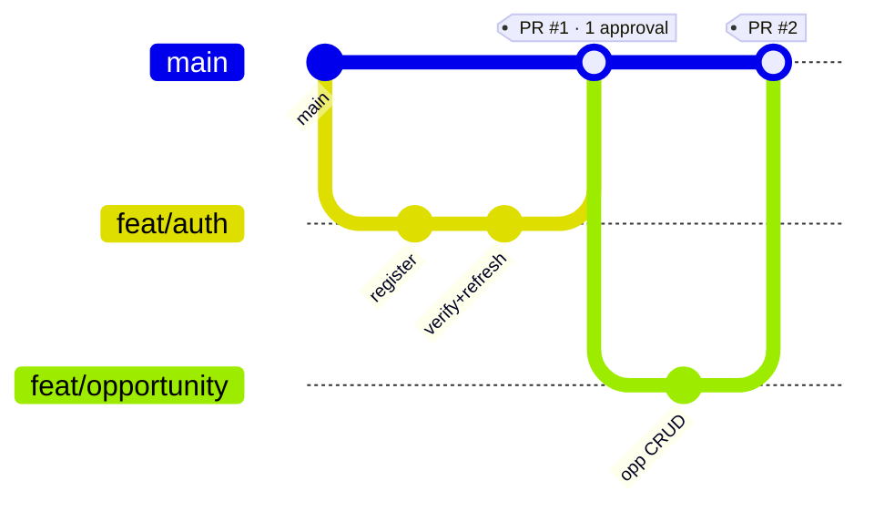

<div align="center">

# 📏 Engineering Rules & Conventions
## Thapar Nexus — How We Build, Together

`UCS503 Software Engineering` · **Document 8 of 8** · Derived from `MasterPlan.md`

</div>

---

## Table of Contents

1. [Git Strategy](#1-git-strategy)
2. [Commit & PR Conventions](#2-commit--pr-conventions)
3. [Code Standards](#3-code-standards)
4. [API Conventions](#4-api-conventions)
5. [Database Conventions](#5-database-conventions)
6. [Testing Rules](#6-testing-rules)
7. [Definition of Done](#7-definition-of-done)
8. [Security Rules](#8-security-rules)
9. [Documentation Rules](#9-documentation-rules)

---

## 1. Git Strategy

**Repository:** https://github.com/HarshdeepAthawale/UCS503-Software-Engineering

| Rule | Detail |
|---|---|
| **Protected `main`** | No direct pushes. Every change lands via PR with **≥ 1 approval**. |
| **Branch naming** | `feat/<scope>`, `fix/<scope>`, `chore/<scope>`, `docs/<scope>`, `test/<scope>` |
| **Short-lived branches** | Branch from `main`, merge back within a day or two; rebase to stay current |
| **Green before merge** | CI (lint → typecheck → test → migrate) must pass |



---

## 2. Commit & PR Conventions

### 2.1 Conventional Commits

```
<type>(<scope>): <subject>

feat(application): enforce budget under SERIALIZABLE txn
fix(auth): rotate refresh token family on reuse
docs(schema): add attestation CHECK constraint rationale
test(opportunity): cover expiry job transition
chore(ci): add prisma migrate deploy step
```

Types: `feat` · `fix` · `docs` · `test` · `chore` · `refactor` · `perf`.

> **⚠️ Attribution rule:** Commits are authored as `harshdeepathawale777@gmail.com`. **Never** add `Co-Authored-By` trailers or any AI attribution to commits.

### 2.2 PR Template

```markdown
## What
<one-line summary>

## Why
<link to requirement ID / task ID in Tracker.md>

## How
<key implementation notes>

## Testing
- [ ] Unit
- [ ] Integration
- [ ] E2E (if user-facing)

## Checklist
- [ ] Traceability matrix updated (Tracker.md)
- [ ] No secrets committed
- [ ] Docs updated if behaviour changed
```

**Review requirement:** minimum one approval; the reviewer checks the Definition of Done (§7).

---

## 3. Code Standards

| Rule | Detail |
|---|---|
| **TypeScript strict** | `strict: true`; **no `any`** (use `unknown` + narrowing) |
| **Naming** | `camelCase` variables/functions, `PascalCase` types/components, `UPPER_SNAKE` constants |
| **Files/folders** | Feature-first: `src/features/<domain>/{service,routes,schema,tests}` |
| **Import ordering** | 1) node/std, 2) external, 3) internal aliases, 4) relative — separated by blank lines |
| **Validation at boundary** | Every request body/query parsed with the shared Zod schema before use |
| **Pure domain logic** | TTA, Jaccard, budget checks live in pure, unit-tested functions |
| **No magic numbers** | Budget, SLA windows, token lifetimes come from config/constants |

---

## 4. API Conventions

| Rule | Detail |
|---|---|
| **Resource naming** | Plural nouns: `/opportunities`, `/applications`, `/attestations` |
| **Status codes** | `200` ok · `201` created · `204` no content · `400` validation · `401` auth · `403` RBAC · `404` missing · `409` conflict · `410` gone · `422` domain rule · `429` rate limit |
| **Error envelope** | `{ error: { code, message, field, requestId } }` — consistent everywhere |
| **Pagination** | Cursor-based: `?cursor=&limit=`; response includes `nextCursor` |
| **Idempotency** | Mutations that must not double-apply accept `Idempotency-Key` |
| **Rate limiting** | Every mutation is rate-limited (auth, apply, messaging most aggressively) |

---

## 5. Database Conventions

| Rule | Detail |
|---|---|
| **Casing** | `snake_case` columns and tables |
| **Table names** | Plural (`users`, `applications`, `application_events`) |
| **Primary keys** | `uuid` via `gen_random_uuid()` |
| **Timestamps** | `created_at`, `updated_at`, `deleted_at` (timestamptz) on every table |
| **Soft delete** | `deleted_at` — nothing hard-deleted (analytics integrity) |
| **Product rules in schema** | Encode invariants as constraints (see `Schema.md` §6), not just app code |
| **Parameterised only** | No string-built SQL, ever — Prisma or parameterised queries |
| **Migrations** | Every schema change is a reviewed Prisma migration; forward-only in prod |

---

## 6. Testing Rules

| What | Rule |
|---|---|
| **Must-have-a-test-before-merge** | Any domain-logic function (TTA, budget, Jaccard, state transitions) and any new API endpoint |
| **Levels** | Vitest (unit), Supertest (integration), Playwright (E2E happy paths) |
| **Regression** | Every fixed bug gets a test that would have caught it |
| **Determinism** | No time/random flakiness — inject clock/seed |
| **Critical invariants** | Immutability of `application_events`, budget race, attestation gating each have a dedicated integration test |

---

## 7. Definition of Done

A task is **Done** only when **all** hold:

- [ ] Code merged to `main` via approved PR with green CI
- [ ] Zod validation at the boundary; TypeScript strict, no `any`
- [ ] Unit + integration tests written and passing (E2E if user-facing)
- [ ] Traceability matrix (`Tracker.md`) updated: requirement → module → test
- [ ] No secrets committed; inputs validated; queries parameterised
- [ ] Accessibility respected for UI (WCAG 2.1 AA, never colour-only status)
- [ ] Module README updated if behaviour changed; decision logged if architectural

---

## 8. Security Rules

| Rule | Detail |
|---|---|
| **Never commit secrets** | `.env` git-ignored; secrets in platform store; scan on CI |
| **Validate every input** | Zod at the boundary — bodies, params, queries |
| **Parameterised queries only** | No dynamic SQL string building |
| **Rate-limit every mutation** | Redis token bucket per user + per IP |
| **Hash passwords** | scrypt (impl) / Argon2 / bcrypt; per-hash salt; never store plaintext |
| **Rotate refresh tokens** | 7d refresh, rotation with theft-detection family |
| **Least privilege** | RBAC on every resource action (`TechSpecifications.md` §6.2) |
| **No PII in URLs/logs** | Never place personal/sensitive data in query strings or log payloads |
| **Audit privileged actions** | Role changes, moderation, attestation, admin overrides → `audit_log` |

---

## 9. Documentation Rules

| Rule | Detail |
|---|---|
| **Module README** | Every feature module gets a README: purpose, key files, how to run its tests |
| **Decision log** | Every architectural decision → an entry in `Tracker.md` §5 (date, decision, alternatives, rationale) |
| **Docs mirror behaviour** | If behaviour changes, the relevant doc changes in the same PR |
| **Source of truth** | `MasterPlan.md` is parent; no child doc contradicts it — change it there first, then propagate |
| **Diagrams** | Keep Mermaid diagrams in-repo and text-based so they diff cleanly in PRs |

---

<div align="center">

[← Tracker](Tracker.md) &nbsp;·&nbsp; **Rules** &nbsp;·&nbsp; [Docs Index →](README.md)

_Protected `main`, one approval, green CI, tests before merge, secrets never committed._

</div>
