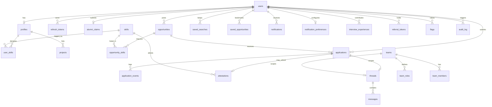
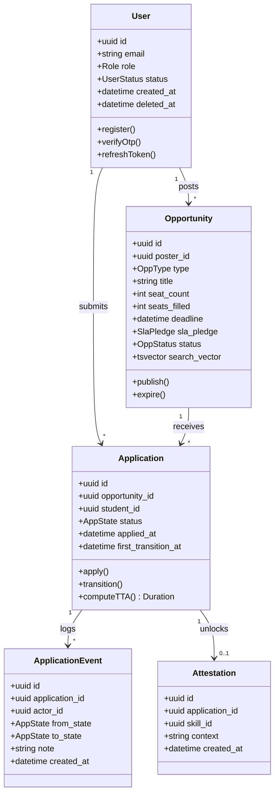
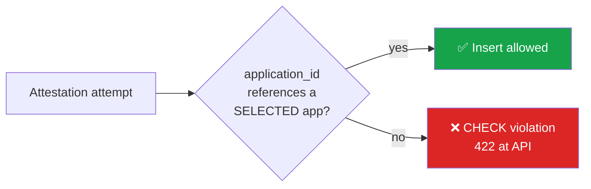

<div align="center">

# 🗄️ Data Schema
## Thapar Nexus — ER Model, DDL & Constraints That Carry the Design

`UCS503 Software Engineering` · **Document 5 of 8** · Derived from `MasterPlan.md`

</div>

---

## Table of Contents

1. [Entity Map](#1-entity-map)
2. [ER Diagram](#2-er-diagram)
3. [Class Diagram](#3-class-diagram)
4. [Enumerations](#4-enumerations)
5. [DDL — Table by Table](#5-ddl--table-by-table)
6. [Constraints That Carry the Design](#6-constraints-that-carry-the-design-) ⭐
7. [Derived Values Policy](#7-derived-values-policy)
8. [Migration & Rollback](#8-migration--rollback-strategy)
9. [Seed Data](#9-seed-data-specification)
10. [Retention & Soft-Delete](#10-retention--soft-delete-policy)

---

## 1. Entity Map

| Domain | Tables |
|---|---|
| **Identity** | `users`, `refresh_tokens`, `alumni_claims` |
| **Profile** | `profiles`, `skills`, `user_skills`, `projects`, `attestations` |
| **Opportunity** | `opportunities`, `opportunity_skills`, `saved_searches`, `saved_opportunities` |
| **Application** | `applications`, `application_events`, `rejection_reasons` |
| **Team** | `teams`, `team_roles`, `team_members` |
| **Communication** | `threads`, `messages`, `notifications`, `notification_preferences` |
| **Content** | `interview_experiences`, `referral_tokens` |
| **Governance** | `flags`, `audit_log`, `admin_actions` |

---

## 2. ER Diagram



---

## 3. Class Diagram



---

## 4. Enumerations

| Enum | Values |
|---|---|
| `Role` | `STUDENT`, `FACULTY`, `ALUMNI`, `ADMIN` |
| `UserStatus` | `UNVERIFIED`, `ACTIVE`, `PENDING_ALUMNI`, `SUSPENDED` |
| `OppType` | `RESEARCH`, `INTERNSHIP`, `TA`, `HACKATHON_TEAM`, `MICRO_TASK`, `REFERRAL` |
| `OppStatus` | `DRAFT`, `LIVE`, `AT_RISK`, `EXPIRED`, `CLOSED` |
| `SlaPledge` | `H24`, `H48`, `WEEK` |
| `AppState` | `APPLIED`, `RECEIVED`, `SHORTLISTED`, `INTERVIEW`, `SELECTED`, `REJECTED`, `WITHDRAWN` |
| `Proficiency` | `BEGINNER`, `INTERMEDIATE`, `ADVANCED`, `EXPERT` |
| `RejectionCode` | `SKILL_MISMATCH`, `SEATS_FILLED`, `TIMING_CONFLICT`, `PROFILE_INCOMPLETE`, `STRONGER_APPLICANTS`, `OTHER` |
| `NotifFreq` | `IMMEDIATE`, `DAILY`, `WEEKLY` |

---

## 5. DDL — Table by Table

> Conventions (see `Rules.md`): `snake_case`, plural table names, `id uuid PRIMARY KEY DEFAULT gen_random_uuid()`, `created_at`/`updated_at`/`deleted_at timestamptz` on every table.

### 5.1 `users`

```sql
CREATE TABLE users (
    id            uuid PRIMARY KEY DEFAULT gen_random_uuid(),
    email         citext NOT NULL UNIQUE,
    password_hash text   NOT NULL,
    role          role_enum NOT NULL DEFAULT 'STUDENT',
    status        user_status_enum NOT NULL DEFAULT 'UNVERIFIED',
    name          text   NOT NULL,
    created_at    timestamptz NOT NULL DEFAULT now(),
    updated_at    timestamptz NOT NULL DEFAULT now(),
    deleted_at    timestamptz
);
CREATE INDEX idx_users_role ON users(role) WHERE deleted_at IS NULL;
```

### 5.2 `refresh_tokens`

```sql
CREATE TABLE refresh_tokens (
    id          uuid PRIMARY KEY DEFAULT gen_random_uuid(),
    user_id     uuid NOT NULL REFERENCES users(id),
    token_hash  text NOT NULL,
    family_id   uuid NOT NULL,           -- rotation family for theft detection
    revoked_at  timestamptz,
    expires_at  timestamptz NOT NULL,
    created_at  timestamptz NOT NULL DEFAULT now()
);
CREATE INDEX idx_refresh_user ON refresh_tokens(user_id) WHERE revoked_at IS NULL;
```

### 5.3 `alumni_claims`

```sql
CREATE TABLE alumni_claims (
    id           uuid PRIMARY KEY DEFAULT gen_random_uuid(),
    user_id      uuid NOT NULL REFERENCES users(id),
    roll_no      text NOT NULL,
    grad_year    int  NOT NULL,
    degree       text NOT NULL,
    proof_url    text NOT NULL,
    decision     text CHECK (decision IN ('APPROVED','REJECTED')),
    decision_reason text,
    reviewed_by  uuid REFERENCES users(id),
    created_at   timestamptz NOT NULL DEFAULT now()
);
```

### 5.4 `profiles`, `skills`, `user_skills`, `projects`

```sql
CREATE TABLE profiles (
    user_id    uuid PRIMARY KEY REFERENCES users(id),
    branch     text, year int,
    cgpa       numeric(3,2),           -- private by default
    cgpa_public boolean NOT NULL DEFAULT false,
    bio        text,
    updated_at timestamptz NOT NULL DEFAULT now()
);

CREATE TABLE skills (               -- admin-curated taxonomy, NOT free text
    id   uuid PRIMARY KEY DEFAULT gen_random_uuid(),
    name text NOT NULL UNIQUE,
    domain text NOT NULL
);

CREATE TABLE user_skills (
    user_id     uuid REFERENCES users(id),
    skill_id    uuid REFERENCES skills(id),
    proficiency proficiency_enum NOT NULL,
    PRIMARY KEY (user_id, skill_id)   -- composite PK, proficiency as enum
);

CREATE TABLE projects (
    id        uuid PRIMARY KEY DEFAULT gen_random_uuid(),
    user_id   uuid NOT NULL REFERENCES users(id),
    title     text NOT NULL,
    repo_url  text,
    verified_at timestamptz,          -- set by S7 background job
    repo_meta jsonb,                  -- name, language, stars, last commit
    created_at timestamptz NOT NULL DEFAULT now()
);
```

### 5.5 `opportunities`, `opportunity_skills`

```sql
CREATE TABLE opportunities (
    id            uuid PRIMARY KEY DEFAULT gen_random_uuid(),
    poster_id     uuid NOT NULL REFERENCES users(id),
    type          opp_type_enum NOT NULL,
    title         text NOT NULL,
    description   text NOT NULL,
    domain        text NOT NULL,
    duration      text,
    stipend       boolean NOT NULL DEFAULT false,
    seat_count    int NOT NULL CHECK (seat_count > 0),
    seats_filled  int NOT NULL DEFAULT 0,
    deadline      timestamptz NOT NULL,
    sla_pledge    sla_pledge_enum NOT NULL,
    status        opp_status_enum NOT NULL DEFAULT 'LIVE',
    search_vector tsvector,
    created_at    timestamptz NOT NULL DEFAULT now(),
    updated_at    timestamptz NOT NULL DEFAULT now(),
    deleted_at    timestamptz,
    CONSTRAINT seats_within_capacity CHECK (seats_filled <= seat_count)
);
CREATE INDEX idx_opp_search ON opportunities USING GIN (search_vector);
CREATE INDEX idx_opp_facets ON opportunities(type, domain, stipend) WHERE deleted_at IS NULL;

CREATE TABLE opportunity_skills (
    opportunity_id uuid REFERENCES opportunities(id),
    skill_id       uuid REFERENCES skills(id),
    requirement    text NOT NULL CHECK (requirement IN ('REQUIRED','PREFERRED')),
    PRIMARY KEY (opportunity_id, skill_id)
);
```

### 5.6 `applications`, `application_events`, `attestations`

```sql
CREATE TABLE applications (
    id             uuid PRIMARY KEY DEFAULT gen_random_uuid(),
    opportunity_id uuid NOT NULL REFERENCES opportunities(id),
    student_id     uuid NOT NULL REFERENCES users(id),
    status         app_state_enum NOT NULL DEFAULT 'APPLIED',
    applied_at     timestamptz NOT NULL DEFAULT now(),
    first_transition_at timestamptz,      -- stamped once, drives TTA
    rejection_code rejection_code_enum,
    created_at     timestamptz NOT NULL DEFAULT now(),
    deleted_at     timestamptz
);
-- One LIVE application per student per opportunity
CREATE UNIQUE INDEX uq_one_live_app
    ON applications(opportunity_id, student_id)
    WHERE deleted_at IS NULL;

CREATE TABLE application_events (         -- INSERT-ONLY (append log)
    id             uuid PRIMARY KEY DEFAULT gen_random_uuid(),
    application_id uuid NOT NULL REFERENCES applications(id),
    actor_id       uuid NOT NULL REFERENCES users(id),
    from_state     app_state_enum,
    to_state       app_state_enum NOT NULL,
    note           text,
    created_at     timestamptz NOT NULL DEFAULT now()
);
-- Revoke UPDATE/DELETE at role level → immutability, the basis of trustworthy TTA
REVOKE UPDATE, DELETE ON application_events FROM app_write_role;

CREATE TABLE attestations (
    id             uuid PRIMARY KEY DEFAULT gen_random_uuid(),
    application_id uuid NOT NULL REFERENCES applications(id),  -- NOT NULL
    skill_id       uuid NOT NULL REFERENCES skills(id),
    issuer_id      uuid NOT NULL REFERENCES users(id),
    context        text NOT NULL,
    created_at     timestamptz NOT NULL DEFAULT now()
);
```

### 5.7 `threads`, `messages`, `notifications`

```sql
CREATE TABLE threads (
    id             uuid PRIMARY KEY DEFAULT gen_random_uuid(),
    application_id uuid REFERENCES applications(id),
    team_id        uuid REFERENCES teams(id),
    created_at     timestamptz NOT NULL DEFAULT now(),
    CONSTRAINT thread_must_be_scoped
        CHECK (application_id IS NOT NULL OR team_id IS NOT NULL)
);

CREATE TABLE messages (
    id         uuid PRIMARY KEY DEFAULT gen_random_uuid(),
    thread_id  uuid NOT NULL REFERENCES threads(id),
    sender_id  uuid NOT NULL REFERENCES users(id),
    body       text NOT NULL,
    created_at timestamptz NOT NULL DEFAULT now()
);

CREATE TABLE notification_preferences (
    user_id  uuid PRIMARY KEY REFERENCES users(id),
    freq     notif_freq_enum NOT NULL DEFAULT 'DAILY',
    categories jsonb NOT NULL DEFAULT '{}'
);
```

### 5.8 Governance — `audit_log`

```sql
CREATE TABLE audit_log (              -- append-only
    id         uuid PRIMARY KEY DEFAULT gen_random_uuid(),
    actor_id   uuid REFERENCES users(id),
    action     text NOT NULL,
    target     text,
    metadata   jsonb,
    created_at timestamptz NOT NULL DEFAULT now()
);
```

_(Remaining tables — `saved_searches`, `saved_opportunities`, `teams`, `team_roles`, `team_members`, `interview_experiences`, `referral_tokens`, `flags`, `admin_actions`, `rejection_reasons` — follow the same conventions: uuid PK, timestamp columns, soft delete where user-generated.)_

---

## 6. Constraints That Carry the Design ⭐

> Each of these encodes a **product rule in the database** rather than in application code — the correct place for it. **Lead the discussion with attestations.**

| # | Constraint | Product rule it encodes |
|---|---|---|
| **1** ⭐ | `attestations.application_id` **NOT NULL** + `CHECK` that referenced application `status = 'SELECTED'` | **Attestations are unfarmable.** You cannot trade endorsements with friends — a completed engagement must exist first. This is the single strongest feature, enforced in the schema, not a service method. |
| **2** | `application_events` **insert-only**; `REVOKE UPDATE, DELETE` at role level | **TTA is trustworthy** because the event log cannot be rewritten. Corrections are new events. |
| **3** | `UNIQUE (opportunity_id, student_id) WHERE deleted_at IS NULL` on `applications` | One live application per student per opportunity. |
| **4** | `CHECK (seats_filled <= seat_count)` on `opportunities` | Seats can never be over-allocated. |
| **5** | Application budget — partial-count query inside the *same* transaction as the insert, under `SERIALIZABLE` isolation (or row-level advisory lock) | Prevents a race that would let a student exceed the budget by double-submitting. |
| **6** | `user_skills` composite PK `(user_id, skill_id)`; proficiency as **enum**, not integer | No duplicate skill rows; proficiency is a controlled vocabulary. |
| **7** | `threads` `CHECK (application_id IS NOT NULL OR team_id IS NOT NULL)` | **Scoped messaging enforced structurally** — a thread cannot float free of an application or team. |
| **8** | `opportunities.search_vector` generated `tsvector` + GIN index, maintained by trigger | Faceted full-text search without a separate cluster. |



---

## 7. Derived Values Policy

> **Compute, never store.** TTA, responsiveness score, match score, and readiness percentage are all computed from base tables. **Materialise into a nightly-refreshed view only if a query becomes slow; never let them drift as denormalised columns.**

| Derived value | Formula | Source |
|---|---|---|
| **TTA** | `first_transition_at − applied_at` | `applications` |
| **Responsiveness** | rolling response rate + median TTA over a poster's applications | `application_events` |
| **Match score** | Jaccard over skill-tag sets | `user_skills` ∩ `opportunity_skills` |
| **Readiness %** | student tags ÷ aggregated required tags across live postings in a domain | join of `user_skills`, `opportunity_skills`, `opportunities` |

---

## 8. Migration & Rollback Strategy

- **Prisma migrations** are the single source of schema truth; every migration is a version-controlled artifact reviewed in a PR.
- **Forward-only in production**; each migration has a documented manual rollback path in its PR description.
- **Expand → migrate → contract** pattern for breaking changes (add column, backfill, switch reads, drop old).
- CI runs `prisma migrate deploy` against a throwaway database before merge (see `TechSpecifications.md` §8).

---

## 9. Bootstrap Policy — no mock data

The database ships **empty of application data**. There are **no seeded users, profiles, opportunities, applications, or sample skills** — every record is created by a real user through the real flows. This keeps analytics and the pilot honest (no synthetic rows contaminating TTA or resolution metrics).

The single exception is a **bootstrap administrator**, because only an admin can approve the first alumni claims and curate the taxonomy. It is provisioned from **operator-supplied environment credentials**, never from committed values:

```bash
ADMIN_EMAIL=you@thapar.edu ADMIN_PASSWORD='<strong-secret>' npm run bootstrap:admin
```

The script (`prisma/bootstrap-admin.ts`) refuses to run without real credentials, uses no default password, and is idempotent (does nothing if an admin already exists). The **skill taxonomy is curated by the admin in-app** (feature M9), not pre-seeded.

> For automated tests, fixtures are created and torn down *within each test*, never persisted to a shared/seeded database.

---

## 10. Retention & Soft-Delete Policy

| Policy | Rule |
|---|---|
| **Soft delete** | `deleted_at` everywhere; nothing hard-deleted → preserves analytics integrity |
| **Append-only tables** | `application_events`, `audit_log` are never deleted |
| **Privacy defaults** | CGPA + contact private (`cgpa_public = false`) until the user opts in |
| **Token hygiene** | Expired/revoked `refresh_tokens` pruned by a periodic job (rows past `expires_at` + 30d) |
| **Expiry** | Opportunities past deadline → `EXPIRED`; retained for analytics, hidden from discovery |

---

<div align="center">

[← Design](Design.md) &nbsp;·&nbsp; **Schema** &nbsp;·&nbsp; [ImplementationPlan →](ImplementationPlan.md)

_Constraint #1 is the thesis in SQL: competency cannot be farmed._

</div>
