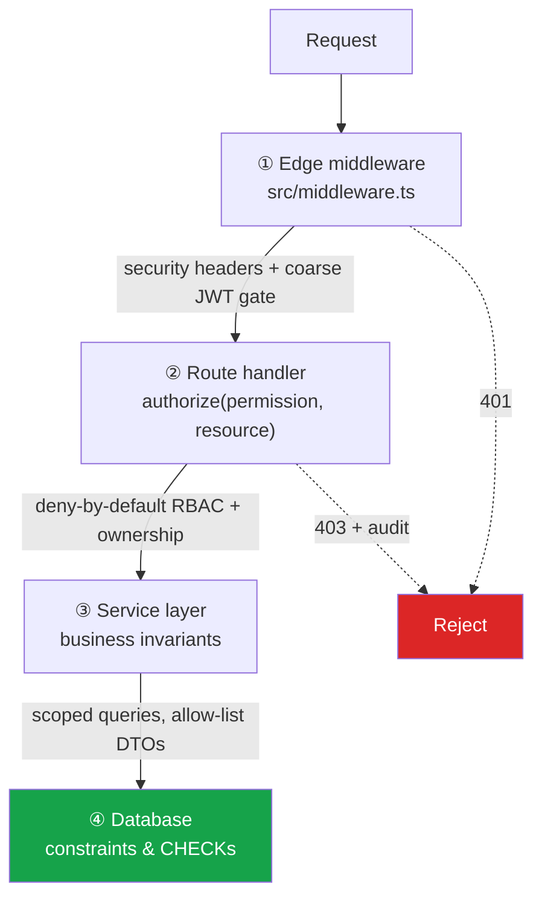
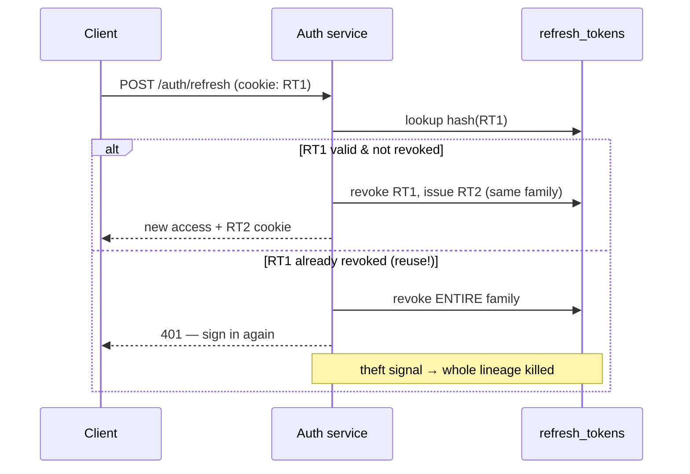

# 🔐 Security & IAM Model
## Thapar Nexus — Identity, Access, and Defense-in-Depth

`UCS503 Software Engineering` · Phase 1 companion to `TechSpecifications.md`

> This document records how identity and access management are actually implemented
> in the Phase 1 codebase. It maps each control to its source file and to the
> CodeGuard rule it satisfies.

---

## 1. Defense-in-Depth: four enforcement layers

Authorization is checked at **every** layer, not just one. A request must pass all of them.

| Layer | File | Responsibility |
|---|---|---|
| ① **Edge middleware** | `src/middleware.ts` | Security headers (CSP/HSTS/etc.); coarse "is there a valid token?" gate. Cheap early reject — **not** authoritative. |
| ② **Route guard** | `src/lib/iam/guard.ts` | `authorize()` runs the RBAC matrix + ownership on every protected handler; denials audited. |
| ③ **Service** | `src/lib/services/*` | Enforces business invariants; scoped queries; allow-list DTOs prevent mass assignment. |
| ④ **Database** | `prisma/schema.prisma` | Uniqueness, composite keys, and (later phases) CHECK constraints encode product rules structurally. |

> **Key principle:** the access token proves *authentication*; the authoritative **role and status are re-loaded from the database on every request** (`src/lib/iam/context.ts`). A stolen or stale token cannot outrun a suspension or role change.

---

## 2. Authentication

| Control | Implementation | CodeGuard |
|---|---|---|
| Password hashing | **scrypt** (N=2¹⁵, r=8, per-hash salt; Node built-in, no native deps) — `security/password.ts` | authentication-mfa |
| Institutional identity | Domain-restricted `@thapar.edu` at the Zod boundary — `validation/schemas.ts` | input-validation |
| Email verification | 6-digit OTP, **hashed + TTL + attempt cap**, constant-time compare — `security/otp.ts` | authentication-mfa |
| Access token | Short-lived (15m) JWT via `jose`, issuer/audience-bound, carries no PII — `security/tokens.ts` | session-management |
| Refresh token | Opaque 256-bit CSPRNG, **stored only as SHA-256 hash**, HttpOnly cookie — `security/tokens.ts`, `security/cookies.ts` | session-management |
| Account enumeration | Uniform responses on register/login; dummy-hash verify on unknown email | authentication-mfa |
| Brute-force | Rate limiting per IP and per email — `security/rate-limit.ts` | authentication-mfa |

### 2.1 Refresh-token rotation & theft detection

Every refresh **rotates** the token. Presenting an already-rotated token is treated as theft: the whole family is revoked and the event is audited (`auth.refresh.reuse_detected`).

---

## 3. Authorization (RBAC)

The single source of truth is the **authorization matrix** in `src/lib/iam/permissions.ts`.

- **Deny by default** — a role can do only what is explicitly granted; unknown permissions are denied.
- **Ownership scoping** — permissions like `profile:update` require `actor === resource owner`, preventing IDOR / horizontal escalation. Missing owner → **fail closed**.
- **Status gate** — `SUSPENDED` passes nothing; `UNVERIFIED` / `PENDING_ALUMNI` are read-only.
- **Mass-assignment safe** — Zod `.strict()` DTOs mean `role`/`status` can never be set by a client.

### 3.1 Role × permission (excerpt)

| Permission | Student | Faculty | Alumni | Admin |
|---|:---:|:---:|:---:|:---:|
| `opportunity:read` | ✅ | ✅ | ✅ | ✅ |
| `application:create` | ✅ | ❌ | ❌ | ❌ |
| `opportunity:create` | ❌ | ✅ | ✅* | ❌ |
| `attestation:create` | ❌ | ✅ | ✅* | ❌ |
| `alumni_claim:approve` | ❌ | ❌ | ❌ | ✅ |
| `skill_taxonomy:read` | ✅ | ✅ | ✅ | ✅ |
| `skill_taxonomy:manage` | ❌ | ❌ | ❌ | ✅ |
| `analytics:read` | ❌ | ❌ | ❌ | ✅ |

_\*Alumni gain posting/attesting rights only once their claim is approved (status `ACTIVE`)._

**Skill taxonomy (T-07).** The vocabulary is **admin-curated, not free text**: only `skill_taxonomy:manage` (ADMIN) can create/rename/delete entries (`/api/admin/skills`), and every mutation is audited (`skill.created` / `skill.updated` / `skill.deleted`). Deletion is **soft** (`deleted_at`) so `user_skills` history and analytics stay intact. Users assign skills to their own profile only (`profile:update` + ownership) and only from the live taxonomy — a soft-deleted or unknown `skillId` is rejected by the service before any write (`/api/profiles/me/skills`).

The matrix is **test-driven**: `tests/iam/authorization-matrix.test.ts` asserts allow/deny for each cell, so any change that widens access fails CI.

---

## 4. Transport & session hardening

| Control | Detail |
|---|---|
| Cookie flags | `HttpOnly; Secure; SameSite=Strict; Path=/api/auth` — XSS can't read it, CSRF can't send it cross-site |
| Security headers | CSP, HSTS (2y, preload), `X-Frame-Options: DENY`, `nosniff`, tight Referrer/Permissions policy — `middleware.ts` |
| No caching of secrets | `Cache-Control: no-store` on every API response — `http/respond.ts` |
| Error hygiene | Generic envelopes; no stack traces or existence leaks — `http/errors.ts` |

---

## 5. Auditing & privacy

- **Append-only audit log** (`security/audit.ts`) records auth events, authz denials, and privileged admin actions — with **rationale codes and ids only, never PII/tokens/OTPs** (codeguard-0-logging).
- **Field-level privacy**: CGPA is private by default and exposed only to the owner, an admin, or when explicitly made public (`services/profile.service.ts`).
- **Soft delete** everywhere; nothing is hard-deleted.

---

## 6. Secrets

- All secrets come from the environment and are **validated at boot** (`src/lib/env.ts`) — the app refuses to start with a weak/missing signing secret, or with the two JWT secrets equal.
- `.env` is git-ignored; `.env.example` documents the shape with **no real values** (codeguard-1-hardcoded-credentials).
- **No mock data or committed accounts.** The database starts empty; the only bootstrap is a single admin provisioned from operator-supplied `ADMIN_EMAIL` / `ADMIN_PASSWORD` (`prisma/bootstrap-admin.ts`), which refuses defaults and is idempotent. Everything else is created by real users through real flows.

---

Phase 1 IAM foundation · every control above is exercised by tests or enforced structurally.

