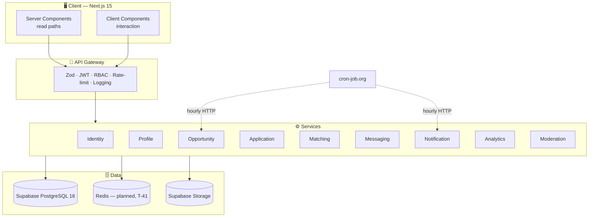
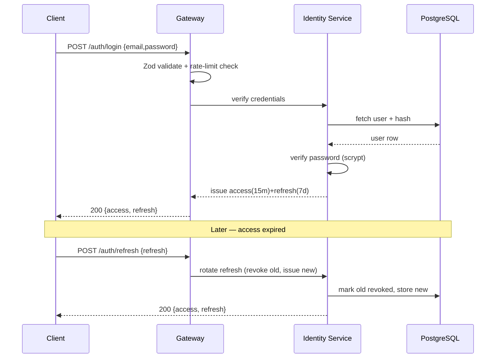
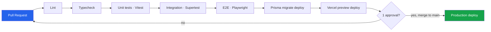

<div align="center">

# 🏗️ Technical Specifications
## Thapar Nexus — Architecture, API & Engineering Decisions

`UCS503 Software Engineering` · **Document 2 of 8** · Derived from `MasterPlan.md`

</div>

---

## Table of Contents

1. [Architecture Overview](#1-architecture-overview)
2. [Layer Responsibilities](#2-layer-responsibilities)
3. [Technology Stack](#3-technology-stack)
4. [Decisions & Trade-offs](#4-decisions--trade-offs) ⭐
5. [API Surface](#5-api-surface)
6. [Authentication & Authorization](#6-authentication--authorization)
7. [Cross-Cutting Concerns](#7-cross-cutting-concerns)
8. [CI/CD Pipeline](#8-cicd-pipeline)
9. [Environment & Configuration](#9-environment--configuration)
10. [Observability](#10-observability)

---

## 1. Architecture Overview

Nexus deploys as **one Next.js unit** (single deployable) with a service-oriented internal structure. Read paths use **React Server Components**; interaction uses **Client Components**.

```
┌───────────────────────────────────────────────────────────────────────┐
│  CLIENT — Next.js 15 (App Router), TypeScript, hand-authored CSS       │
│  Server Components (reads) · Client Components (interaction)           │
└───────────────────────────────┬───────────────────────────────────────┘
                                 │  HTTPS / JSON
┌───────────────────────────────▼───────────────────────────────────────┐
│  API GATEWAY — Route Handlers / Express                               │
│  Routing · Zod validation · Rate limiting · JWT verify · RBAC · Logs  │
└───────────────────────────────┬───────────────────────────────────────┘
                                 │
┌───────────────────────────────▼───────────────────────────────────────┐
│  SERVICES                                                             │
│  Identity · Profile · Opportunity · Application · Matching ·         │
│  Messaging · Notification · Analytics · Moderation                   │
└───────────────────────────────┬───────────────────────────────────────┘
                                 │
┌───────────────────────────────▼───────────────────────────────────────┐
│  DATA                                                                 │
│  Supabase PostgreSQL 16 (source of truth) · Redis PLANNED (T-41)     │
│  Postgres FTS + pg_trgm (search) · Supabase Storage (résumé PDFs)    │
└───────────────────────────────────────────────────────────────────────┘
```



---

## 2. Layer Responsibilities

| Layer | Owns | Must NOT do |
|---|---|---|
| **Client** | Rendering, form UX, optimistic updates, accessibility | Business rules, trust decisions, secrets |
| **API Gateway** | Validation, authN/authZ, rate limiting, request logging, error envelope | Domain logic |
| **Services** | Domain logic, transactions, invariants, job scheduling | Presentation concerns |
| **Data** | Integrity, constraints (the product rules live here), FTS indexes | Application logic beyond triggers/constraints |

---

## 3. Technology Stack

| Layer | Choice | Justification |
|---|---|---|
| Framework | **Next.js 15 + TypeScript** | One deployable unit, typed end-to-end, fast iteration |
| Styling | **Hand-authored CSS** (`src/app/globals.css`) | Tailwind was planned and never adopted. A single token-driven sheet gives the warm-editorial look, light/dark, and a CSP-safe pre-paint theme stamp (T-32) |
| ORM | **Prisma** | Typed queries; migration history is a version-controlled artifact |
| Database | **Supabase PostgreSQL 16**, Prisma + `@prisma/adapter-pg` (WASM query compiler) | Relational integrity, FTS, JSONB. Not Neon/Railway — see D-18 |
| Cache / Queue | **None shipped.** Rate limiting is in-memory fixed-window (`src/lib/security/rate-limit.ts`); scheduled jobs are plain HTTP endpoints under `/api/cron/*` | Redis + BullMQ remain the Phase-2 target (T-41). Until then the limiter is per-instance, so it does not hold across serverless invocations — a real gap, not a design choice |
| Auth | **Custom JWT** (access 15m + refresh 7d, rotating) | Course expects to *see* auth built, not delegated |
| Validation | **Zod** | One schema shared by client and server |
| Testing | **Vitest** (unit) — 201 tests, shipped. Supertest and Playwright are **not installed** (T-38) | Only the unit level is currently covered |
| CI/CD | **GitHub Actions** — `.github/workflows/ci.yml`: install → `db:generate` → typecheck → test → production build | Lint is excluded: `next lint` is interactive and deprecated in 15.x. Inert until Actions billing clears (B-01) |
| Hosting | **Vercel** (app, target) + **Supabase** (Postgres + object storage). Currently live on **Render** during the migration | Free tier, per-PR previews. Cron is triggered externally by cron-job.org, not by the host — D-27 |

---

## 4. Decisions & Trade-offs ⭐

> This is where **engineering judgement is visible**. Evaluators reward *justified* simplification far more than *unjustified* complexity.

### 4.1 Decision D-01 — Elasticsearch → PostgreSQL FTS + `pg_trgm`

| | |
|---|---|
| **Context** | Original proposal specified Elasticsearch for search. |
| **Decision** | Use Postgres `tsvector` with a **GIN index** + trigram (`pg_trgm`) fuzzy matching. |
| **Rationale** | At pilot scale (tens of postings, low hundreds of users), a separate search cluster adds an operational failure mode and a sync-consistency problem for **zero measurable benefit**. Postgres FTS covers faceted search comfortably. |
| **Migration trigger** | *"If p95 search latency exceeds **300 ms** or the corpus passes **~50k documents**, migrate to a dedicated index."* |
| **Trade-off accepted** | Slightly less advanced relevance tuning now, in exchange for one fewer moving part and transactional consistency between data and index. |

> Naming the threshold is what makes this read as **engineering judgement rather than avoidance**.

### 4.2 Decision D-02 — WebSockets → Optimistic UI + Polling (v1)

| | |
|---|---|
| **Context** | Scoped messaging could use WebSockets for real-time chat. |
| **Decision** | Optimistic UI + **Server-Sent Events or a 10-second poll** for v1. |
| **Rationale** | Scoped messaging in a pipeline app is **not** a real-time chat product; message volume is low and latency tolerance is high. |
| **Upgrade path** | Keep the transport behind an interface so upgrading to **Socket.io is a swap, not a rewrite**. |
| **Trade-off accepted** | Up to ~10s message latency in exchange for radically simpler infrastructure. |

### 4.3 Decision Log Summary

| ID | Decision | Alternatives considered | Status |
|----|----------|------------------------|--------|
| D-01 | Postgres FTS over Elasticsearch | Elasticsearch, Meilisearch | ✅ Accepted |
| D-02 | Polling/SSE over WebSockets | Socket.io from day one | ✅ Accepted |
| D-03 | Custom JWT over Auth0/Clerk | Managed auth provider | ✅ Accepted (course requirement) |
| D-04 | Derived metrics computed, not stored | Denormalised columns | ✅ Accepted |
| D-05 | Constraints in DB, not service code | App-layer enforcement | ✅ Accepted |

---

## 5. API Surface

**Conventions:** REST, plural resource nouns, JSON bodies, consistent error envelope, cursor pagination. All mutating endpoints are rate-limited and accept an `Idempotency-Key` header where noted.

### 5.1 Error Envelope

```json
{
  "error": {
    "code": "APPLICATION_BUDGET_EXCEEDED",
    "message": "You have 10 active applications. Withdraw one to apply.",
    "field": null,
    "requestId": "req_01H..."
  }
}
```

### 5.2 Identity — `/api/auth`

| Method | Path | Auth | Request | Response | Errors |
|---|---|---|---|---|---|
| POST | `/auth/register` | — | `{email, password, name}` | `201 {userId, status:"UNVERIFIED"}` | 400, 409, 422 |
| POST | `/auth/verify-otp` | — | `{email, otp}` | `200 {access, refresh}` | 400, 410 |
| POST | `/auth/login` | — | `{email, password}` | `200 {access, refresh}` | 401, 429 |
| POST | `/auth/refresh` | refresh | `{refresh}` | `200 {access, refresh}` | 401 |
| POST | `/auth/logout` | access | — | `204` | 401 |
| POST | `/auth/alumni-claim` | access | `{rollNo, gradYear, degree, proofUrl}` | `202 {status:"PENDING_ALUMNI"}` | 400, 409 |

### 5.3 Profile — `/api/profiles`

| Method | Path | Auth | Notes |
|---|---|---|---|
| GET | `/profiles/:id` | access | Field-level visibility applied server-side |
| PATCH | `/profiles/me` | access (self) | Partial update, Zod-validated |
| POST | `/profiles/me/skills` | access (self) | Add/upsert one skill: `{skillId, proficiency}` from taxonomy only |
| PUT | `/profiles/me/skills` | access (self) | Replace whole skill set atomically: `{skills:[{skillId, proficiency}]}` (≤ 50) |
| DELETE | `/profiles/me/skills/:skillId` | access (self) | Remove one skill (idempotent) |
| POST | `/profiles/me/projects` | access (self) | `{title, repoUrl, description}` → queues S7 verification |

**Skill taxonomy** — `/api/skills` (GET, any role: the admin-curated controlled vocabulary) and `/api/admin/skills` (+ `/:id`) for ADMIN curation (`skill_taxonomy:manage`): POST create, PATCH rename/re-domain, DELETE soft-delete. Skills are **not free text** (docs/PRD M2).

### 5.4 Opportunity — `/api/opportunities`

| Method | Path | Auth | Notes |
|---|---|---|---|
| GET | `/opportunities` | access | Faceted: `?type=&domain=&skills=&stipend=&sort=&cursor=` |
| GET | `/opportunities/:id` | access | Detail view; increments discovery analytics event |
| POST | `/opportunities` | faculty/alumni | Requires SLA pledge; `Idempotency-Key` |
| PATCH | `/opportunities/:id` | owner | Cannot edit past `EXPIRED` |
| POST | `/opportunities/:id/save` | student | Adds to saved list for reminders |

### 5.5 Application — `/api/applications`

| Method | Path | Auth | Notes |
|---|---|---|---|
| POST | `/applications` | student | Budget check + insert in one `SERIALIZABLE` txn; `Idempotency-Key` |
| GET | `/applications/mine` | student | Full pipeline history per application |
| GET | `/opportunities/:id/applicants` | owner | Poster's applicant pipeline view |
| POST | `/applications/:id/transition` | owner | `{toState, note?, reasonCode?}` → writes immutable event |
| POST | `/applications/:id/withdraw` | student | Frees a budget slot |

### 5.6 Attestation, Matching, Messaging, Notifications, Admin

| Method | Path | Auth | Notes |
|---|---|---|---|
| POST | `/attestations` | faculty/alumni | **Requires a `SELECTED` application** (DB-enforced), `{applicationId, skillId, context}` |
| GET | `/matches/opportunities` | student | Jaccard; returns matched + missing tags |
| GET | `/matches/peers` | student | Similarity matching, explainable |
| POST | `/teams/:id/roles/:roleId/request` | student | Complementarity matching |
| GET | `/threads/:id/messages` | participant | Scoped to application/team |
| POST | `/threads/:id/messages` | participant | Rate-limited |
| GET | `/notifications` | access | Digest per preferences |
| PATCH | `/notification-preferences` | access | Frequency per category |
| GET | `/admin/alumni-claims` | admin | Claim queue |
| POST | `/admin/alumni-claims/:id/decision` | admin | `{decision, reason?}` |
| GET | `/admin/flags` | admin | Flag queue w/ reason codes |
| GET | `/admin/analytics` | admin | Institute metrics |

---

## 6. Authentication & Authorization

### 6.1 Token Design

| Token | Lifetime | Storage | Rotation |
|---|---|---|---|
| Access (JWT) | **15 min** | Memory / short-lived cookie | Re-issued on refresh |
| Refresh (JWT) | **7 days** | HttpOnly, Secure cookie | **Rotating** — old token revoked on use, stored in `refresh_tokens` |

Revocation: refresh tokens are tracked server-side; logout and rotation both invalidate. Reuse of a revoked refresh token invalidates the whole family (theft detection).

### 6.2 RBAC Matrix (role × resource × action)

| Resource / Action | Student | Faculty | Alumni | Admin |
|---|:---:|:---:|:---:|:---:|
| Register / verify | ✅ | ✅ | ✅(claim) | seeded |
| Build own profile | ✅ | ✅ | ✅ | ✅ |
| Publish opportunity | ❌ | ✅ | ✅(approved) | ✅ |
| Apply to opportunity | ✅ | ❌ | ❌ | ❌ |
| Transition application | ❌ | ✅(owner) | ✅(owner) | ✅ |
| Issue attestation | ❌ | ✅ | ✅ | ✅ |
| Approve alumni claim | ❌ | ❌ | ❌ | ✅ |
| Manage taxonomy | ❌ | ❌ | ❌ | ✅ |
| Resolve flags / moderate | ❌ | ❌ | ❌ | ✅ |
| View institute analytics | ❌ | ❌ | ❌ | ✅ |



---

## 7. Cross-Cutting Concerns

| Concern | Implementation |
|---|---|
| **Audit log** | Every privileged action (role change, moderation, attestation, admin override) → append-only `audit_log` |
| **Rate limiting** | Redis token bucket per user & per IP on auth, application submission, messaging |
| **Idempotency** | Application submission and status transitions accept an `Idempotency-Key`; duplicate keys return the original result |
| **Soft deletion** | Nothing hard-deleted; `deleted_at` everywhere → preserves analytics integrity |
| **Data privacy** | CGPA + contact private by default; field-level visibility on the profile |
| **Scheduled jobs** | BullMQ: opportunity expiry, SLA nudge (80% window), digest batching, deadline reminders, repo metadata fetch |

---

## 8. CI/CD Pipeline



| Stage | Tool | Gate |
|---|---|---|
| Lint | ESLint + Prettier | Zero errors |
| Typecheck | `tsc --noEmit` | Zero errors, no `any` |
| Unit | Vitest | Coverage target met |
| Integration | Supertest | All auth/profile/application scenarios pass |
| E2E | Playwright | Happy paths green |
| Migrate | Prisma | Migrations apply cleanly |
| Deploy | Vercel | Preview per PR; production on green merge to `main` |

---

## 9. Environment & Configuration

| Variable | Purpose | Secret? |
|---|---|---|
| `DATABASE_URL` / `DIRECT_URL` | Supabase Postgres (pooled / direct) | ✅ |
| `JWT_ACCESS_SECRET` / `JWT_REFRESH_SECRET` | Token signing — must differ | ✅ |
| `RESEND_API_KEY` / `EMAIL_FROM` | OTP + digest delivery. Without both, the mailer refuses to send in production | ✅ / ❌ |
| `SUPABASE_URL` / `SUPABASE_SERVICE_ROLE_KEY` / `SUPABASE_RESUME_BUCKET` | Résumé object storage. The service-role key is server-only — never `NEXT_PUBLIC` | ✅ / ✅ / ❌ |
| `GOOGLE_CLIENT_ID` / `GOOGLE_CLIENT_SECRET` / `NEXT_PUBLIC_GOOGLE_ENABLED` | Sign in with Google. The `NEXT_PUBLIC_` flag is read at **build** time | ❌ / ✅ / ❌ |
| `CRON_SECRET` | Bearer token for `/api/cron/*`. Unset ⇒ every cron route 404s (fail-closed) | ✅ |
| `APP_ORIGIN` | Canonical public origin; Google matches the redirect URI byte for byte | ❌ |
| `ALLOW_INSECURE_COOKIES` | Dev only. **Must be `false` in production** or the app refuses to boot (B-05) | ❌ |
| `APPLICATION_BUDGET` | Default 10 | ❌ |
| `ALLOWED_EMAIL_DOMAIN` | `thapar.edu` | ❌ |

The authoritative list is `.env.example`; `src/lib/env.ts` validates it at boot.
There is no `REDIS_URL`, `SMTP_*` or `S3_*` — earlier drafts of this table named
variables the code has never read.

Config is environment-driven; secrets live in the platform's secret store (never committed — see `Rules.md`). Three environments: **local**, **staging (preview)**, **production**, kept at parity.

---

## 10. Observability

| Signal | Mechanism |
|---|---|
| **Logging** | Structured JSON request logs with `requestId`; correlation across services |
| **Metrics** | TTA, search latency (p95), job durations, error rate — instrumented from day one |
| **Error tracking** | Captured exceptions with request context; no PII in payloads |
| **Analytics events** | Discovery time, apply funnel, transition events — feed §8 success metrics |

---

<div align="center">

[← PRD](PRD.md) &nbsp;·&nbsp; **TechSpecifications** &nbsp;·&nbsp; [AppFlow →](AppFlow.md)

</div>
